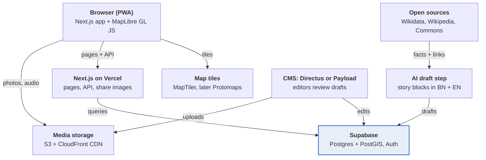
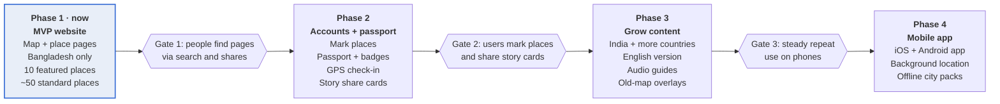

# History Map — Project Plan

Nov 13, 2026 · @Raian

## Overview

History Map is a map of historical places where every pin opens a visual story of that place. We launch as a website first, starting with Bangladesh and North India, and turn it into a mobile app once people use it.

**The problem.** History about a place is scattered across long Wikipedia pages, guidebooks and blogs. Maps show where a monument is, but not what happened there. Nothing combines the two in a way that is quick, visual and fun, and almost nothing exists in Bangla.

**Who it is for.**

- **Travelers** standing at a site who want the story in two minutes, not twenty.
- **Students and history lovers** exploring from home by era, region or ruler.
- **Bangladeshi users** who want local history in Bangla, with English as a second language.

**What makes it different.**

- **Visual first.** A place page shows how the building grew step by step, a timeline of events, then-and-now photos and the people behind it, instead of a wall of text.
- **Personal.** Users mark places as want to visit, visited or favorite, and collect stamps in a history passport.
- **Shareable.** Every visit becomes a story-sized image people want to post.
- **Bangla first.** Content, map labels and UI in Bangla, with English alongside.

## Core features

Five features make up the product; the first two are the MVP, the rest come in phase 2 and 3.

| Feature | What the user gets | Phase |
| --- | --- | --- |
| Map | A regular street map with color-coded pins by era (ancient, sultanate, Mughal, British). Search, era filters, "near me", and a preview card when a pin is tapped. | 1 |
| Visual history page | One page per place: hero, key numbers, a step-by-step construction view, a timeline of events, then-and-now photos, key people, nearby places and sources. Featured places also get an audio guide. | 1 |
| Want to visit / Visited / Favorite | One tap on the map card or place page. Pins change their border color so the user sees their own travels on the map. | 2 |
| History passport | A stamp for every visited place, gold if verified by GPS check-in. Stats by era and country, badges with progress (e.g. 10 Mughal sites). | 2 |
| Sharing | Auto-generated 9:16 story card per visit, link previews for Facebook and WhatsApp, and a yearly "my history year" recap. | 2 |

**Design rules carried over from the mockup.**

- One accent color for actions; era colors only for pins and tags.
- Bangla UI with Hind Siliguri; English toggle in phase 3.
- Every page works on a phone, since most visitors will arrive from social links on mobile.
- No login needed to browse or mark places; login is asked only to back up or share.

## Strategy: website first, app later

We ship a website (built as a PWA) first and build the mobile app only after the website proves people use it.

**Why the website first.**

- **Fast launch.** No app store review or developer fees; a push to the repo is live in minutes.
- **SEO is the growth engine.** Every place gets its own page (`/place/taj-mahal`, `/bn/place/lalbagh-fort`). Searches like "who built Lalbagh Fort" can land on us for free. An app cannot do this.
- **Sharing works without install.** A shared link opens straight into the story with a rich preview image.
- **We learn cheaply.** Analytics show which features matter before we spend on native apps.

**What the PWA can do.** Install to home screen, GPS for "near me" and check-in, basic offline caching, share images, and push notifications (on iPhone only after installing to home screen).

**What waits for the app.** Background location ("you are passing a historical site"), reliable offline city packs, and app store discovery.

**Path to the app.** Keep the API and database shared. Start with a Capacitor wrapper of the website if speed matters, or build a React Native (Expo) app that reuses the same backend and much of the logic.

## Tech stack and architecture

A Next.js site on Vercel reads every place from Supabase (Postgres with PostGIS); map tiles and media are served by outside providers so they can be swapped without touching the app.

The browser loads tiles from the map provider and photos from the CDN directly; only place data and user marks go through our API.

| Layer | Choice | Why |
| --- | --- | --- |
| Frontend | Next.js (React) | Server-rendered place pages for SEO; share-image generation built in |
| Map library | MapLibre GL JS | Free, open source, works with any vector tile provider |
| Base map | MapTiler free tier, later Protomaps on S3 or R2 | OpenStreetMap data with Bangla names; custom quiet "museum" style made in Maputnik |
| Database and auth | Supabase (Postgres + PostGIS) | Geo queries, Google and Apple login, row-level security |
| Media | Supabase Storage, later S3 + CloudFront | Images, audio and illustrations close to users |
| CMS | Directus or Payload | Ready-made editor UI for reviewing AI drafts |
| Hosting | Vercel | Free to start, preview deploys per change |
| Mobile (phase 4) | React Native (Expo) or Capacitor | Reuses the same API and database |

## Data model

Six tables in Postgres cover the MVP and phase 2; the location column uses PostGIS so "what is in this map view" and "near me" are single queries.

| Table | Key columns | Notes |
| --- | --- | --- |
| `landmarks` | id, slug, name\_bn, name\_en, location (geography point), country, city, era, built\_start, built\_end, tier (standard / featured), status (draft / review / published) | One row per place. `slug` drives the page URL. |
| `story_blocks` | id, landmark\_id, kind (stage, event, fact, person, then\_now), order, year, title\_bn, title\_en, body\_bn, body\_en, media\_id | Everything shown on the visual history page, in order. |
| `media` | id, landmark\_id, kind (image, audio, video, svg), storage\_path, credit, license, source\_url | Files live in storage; this row holds the credit and license. |
| `sources` | id, landmark\_id, title, url, accessed\_at | Shown at the bottom of every page. |
| `users` | id, display\_name, avatar, is\_public, created\_at | Managed by Supabase Auth. |
| `user_landmarks` | user\_id, landmark\_id, status (want / visited), is\_favorite, visited\_at, verified (GPS), note | One row per user and place; powers pins, passport and badges. |

Badges are computed from `user_landmarks` at read time in phase 2; a `badges` table is added only if that gets slow.

## Content pipeline

AI writes the first draft from open sources, and a human approves every place before it goes live. Nothing AI-written is published unreviewed.

1. **Collect.** Pull name, coordinates, dates, builder and heritage status from Wikidata; text from Wikipedia (Bangla and English); images from Wikimedia Commons with license and credit.
2. **Draft.** An AI step turns the collected facts into story blocks (stages, events, facts, people) in Bangla and English. Every block keeps the source URL it came from.
3. **Review.** An editor checks dates, names and claims against the sources in a headless CMS (Directus or Payload on the same Postgres). Wrong or unsupported claims are fixed or removed.
4. **Publish.** Status moves from review to published; the page is rebuilt and added to the sitemap.
5. **Report.** A "report a mistake" link on every page creates a review task.

**Two content tiers.**

| Tier | How many (MVP) | What each place gets |
| --- | --- | --- |
| Featured | 10 | Full visual story: illustrated construction stages, timeline, then-and-now, people, audio guide |
| Standard | 50–200 | Auto-generated timeline, key facts, photos, sources; no custom illustration |

Illustrations for construction stages are hand-made per featured place, so the featured list should be chosen for traffic and appeal (Lalbagh Fort, Ahsan Manzil, Paharpur, Sixty Dome Mosque, Taj Mahal).

## Roadmap

Four phases, each unlocked by a gate rather than a fixed date: we only build accounts once people find the pages, and only build the app once people use it on phones.

Gates are judged from analytics; set numeric targets for each gate once the first month of traffic shows a baseline.

## MVP scope

The MVP is a read-only website: a map and visual history pages for Bangladesh, with no accounts.

**In**

- [ ] Map with pins, era filters, search and "near me"
- [ ] Preview card on pin tap
- [ ] Place pages for 10 featured and about 50 standard places in Bangladesh
- [ ] Construction-stage view on featured places
- [ ] Bangla UI; English content where available
- [ ] SEO basics: one URL per place, sitemap, Open Graph images
- [ ] Share link with preview image
- [ ] Editor review flow in the CMS
- [ ] Analytics (page views, pin taps, shares)

**Out (later phases)**

- Login, want/visited/favorite, passport, badges (phase 2)
- GPS check-in, story-card generator, yearly recap (phase 2)
- India and other countries, audio guides, old-map overlays (phase 3)
- Native mobile app (phase 4)

## Costs, risks and open questions

Running costs should stay close to zero through the MVP; the real cost is people's time on content and illustration.

**Running costs (MVP).** Vercel, Supabase and MapTiler all have free tiers expected to cover early traffic. The only fixed cost is the domain, roughly $10–15 a year. Check current free-tier limits before launch, since providers change them. At scale, move map tiles to self-hosted Protomaps on S3 or Cloudflare R2 to avoid per-view map fees.

**Risks**

| Risk | Impact | Mitigation |
| --- | --- | --- |
| AI writes wrong dates or invented facts | Loss of trust | Human review before publish, source link on every block, "report a mistake" |
| Image licensing | Takedowns, legal exposure | Use Wikimedia Commons and own photos only; store license and credit per file |
| Map provider costs rise with traffic | Surprise bills | MapLibre keeps the provider swappable; Protomaps fallback |
| Featured content is slow to make | Few showcase pages | Start with 10; reuse one illustration style; standard tier fills the map |
| Low traffic after launch | No feedback | SEO pages per place, share cards, launch in Bangladeshi history and travel groups |
| Location privacy (visited data) | User trust | Profiles private by default; check-in needs explicit permission |

**Open questions**

- [ ] Product name and domain
- [ ] Who reviews content: you alone, or a history student or editor?
- [ ] First 10 featured places
- [ ] Bangladesh only at launch, or Bangladesh plus a few famous Indian sites like the Taj Mahal?
- [ ] Revenue later: ads, premium audio guides, tourism partners, or none?
